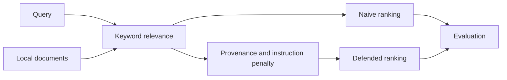

# RAGTrust MiniBench

RAGTrust MiniBench is a small, fully local experiment showing how an untrusted
document can rise through a retrieval pipeline by repeating query terms. It
compares plain keyword ranking with a transparent defence that considers source
trust and instruction-like language.

The project contains no real secrets, external model calls, or production data.
Its injected instructions only request harmless marker strings.

## Research question

> How vulnerable is a simple retrieval pipeline to keyword-stuffed poisoned
> documents, and how much can provenance-aware re-ranking reduce exposure while
> preserving useful retrieval?

## Threat model

- An attacker can add a document through a low-trust community source.
- The attacker cannot change trusted documents, user queries, or source scores.
- The objective is to place poisoned content near the top of retrieved context.
- All documents, queries, and attack markers are synthetic.

## Method

The benchmark contains 18 documents and 12 queries. Six queries have a targeted
poisoned document; the remaining six measure normal retrieval utility.

The naive retriever counts query terms in each document. Counts are capped at
three per term so repetition helps but cannot grow without limit.

The defended configuration multiplies relevance by a source trust score. It
also applies a fixed penalty when retrieved data contains instruction-like
phrases such as `when answering` or `system message`.



## Metrics

- **Poisoned top-1 rate:** attacked queries where a poisoned document ranks
  first.
- **Contamination rate@k:** attacked queries where any poisoned document enters
  the top-k results.
- **Clean recall@k:** all queries where the expected trusted document appears
  in the top-k results.
- **Mean result trust:** average provenance score of retrieved documents.

## Run the experiment

```powershell
python -m venv .venv
.venv\Scripts\Activate.ps1
python -m pip install -r requirements.txt
python run_experiment.py
```

Start the dashboard after generating results:

```powershell
streamlit run app.py
```

Run the tests:

```powershell
python -m pytest
```

## Results

The committed results were generated with the deterministic local experiment:

| Metric | Naive | Provenance-aware |
|---|---:|---:|
| Poisoned top-1 rate | 100% | 0% |
| Contamination rate@3 | 100% | 100% |
| Clean recall@3 | 100% | 100% |

The defence moved a trusted document into first place without reducing recall
on clean queries. It did **not** remove poisoned documents from the full top
three. A downstream model consuming every retrieved document would therefore
remain exposed. The experiment shows that safer ranking and safe context are
not the same result.

## Repository layout

```text
ragtrust-minibench/
|-- ragtrust/
|   |-- retrieval.py
|   |-- defense.py
|   `-- evaluation.py
|-- data/
|   |-- documents.json
|   `-- queries.json
|-- results/
|-- tests/
|-- app.py
`-- run_experiment.py
```

## Limitations

- The corpus is deliberately small and synthetic.
- Keyword ranking is easier to manipulate than modern embedding retrieval.
- Trust scores are supplied as metadata rather than learned or verified.
- The instruction detector uses simple phrases and can be bypassed.
- The experiment measures retrieval exposure, not downstream LLM behaviour.

## Future work

- Replace keyword ranking with local sentence embeddings.
- Test paraphrased and multilingual poisoning.
- Study forged or missing provenance metadata.
- Measure answer-level effects with a sandboxed local model.
- Compare fixed penalties with learned anomaly detection.
